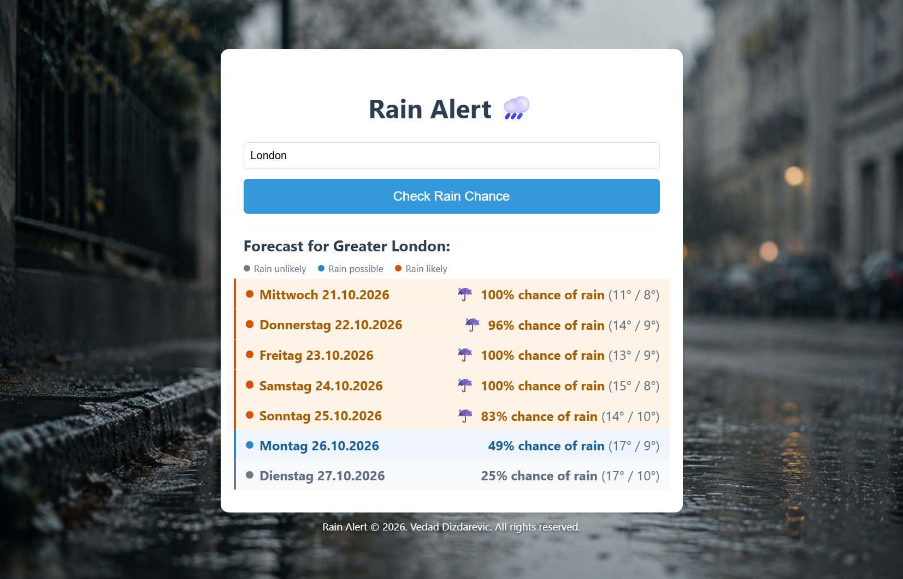

# Rain Alert 🌧️

A small Flask web app that shows the 7-day rain chance for any city, colour-coded
by how wet each day is expected to be.

Type a city name → the app geocodes it to coordinates via
**[Nominatim](https://nominatim.org/)** (OpenStreetMap) → fetches a 7-day
forecast from **[Open-Meteo](https://open-meteo.com/)** → renders a list of
daily rain chances with a visual severity scale, and renames the browser tab
and swaps the favicon when rain is coming.

Both APIs are free, keyless, and need no signup. There is no database, no
user accounts, and nothing to configure before running it.

> **The site is live at <https://rainalert.live/>** — the real page, on the
> `1.1.2` image, with every route answering. The app also runs locally —
> see [Quick start](#quick-start). `DEPLOY.md` is the runbook.



---

## Features

- **Seven-day forecast** for any city the geocoder recognises, with the daily
  maximum rain probability and the high/low temperature.
- **A night street.** The forecast is a dark panel laid over the photograph,
  in the colours of the picture: asphalt, haze, mist, paper, and the amber
  of a street lamp. Amber is the only accent, so a colour on the page
  always means something about the rain. The type is Archivo, self-hosted —
  the page asks no third party for anything, and still works with no
  network.
- **A one-line headline** under the city's name says what the week looks like:
  "Rain likely tomorrow (80%). Bring an umbrella." or "No rain likely for the
  next 7 days." It names the first day worth mentioning, and today's figure
  comes from the hours that are left rather than from a day maximum that
  includes the morning.
- **The tab itself is the alert.** When rain is coming, the browser tab
  renames itself to "Rain tomorrow - Rain Alert" and swaps to a rain
  favicon. A tab left open in the background tells you at a glance that the
  weather changed while you were away — you do not have to switch to the tab
  and read it.
- **Hour-by-hour strip for today.** One bar per hour of the city's local day,
  coloured on the same scale as the week, with every hour's chance written
  over its own bar — so a number never needs a hover to be read, and a
  touch screen never shows one. The current hour is a labelled rule. A
  one-line summary says when the rain is expected — "Rain likely from about
  15:00 to 16:00, up to 83%. Bring an umbrella." — so you can tell whether
  to leave now or in an hour, which a daily maximum cannot.
- **Visual rain severity.** Each day is colour-coded on a three-band scale —
  grey for *rain unlikely*, blue for *rain possible*, amber for *rain likely* —
  and the week is seven columns of figures: the weekday, the chance, the
  temperature, and a ☔ on the days worth carrying an umbrella. The band
  names sit in a key above the week, so the colour never carries the
  meaning on its own.
- **Pick a day, read its rain.** Click any of the seven columns and the
  panel above the week tells you about that day: which day it is, the band
  it is in, the chance, how many millimetres fall in it and how long the
  rain lasts. The days are buttons, so they work with a keyboard as well as
  with a finger, and the page shows today's panel even with JavaScript
  turned off.
- **Celsius or Fahrenheit.** A small switch at the right end of the colour key
  switches the temperatures. The forecast service does the conversion, so the
  numbers are the service's own and the choice sticks when you search for
  another city.
- **English weekday names.** Dates render as `Wednesday 21.10.2026`. The page
  is English throughout, so a German date inside it would be a half-translated
  page; the seven names are hard-coded rather than taken from the C library's
  locale data, so they never depend on the host.
- **Remembers your city and your own rain threshold.** Tick "Remember this
  city" and the next visit loads your forecast by itself — no retyping. Set
  an "Alert me above" percentage and the days that reach it are marked with a
  ▲ and a count of how many qualify. Both live in your browser's
  `localStorage`; the server never sees them and the site stays stateless.
- **A browser notification while the tab is open.** Turn on "Notify me" and the
  page checks the forecast every half hour and says so when rain is about to
  start — "Rain likely from 15:00" — even when you are looking at something
  else. It is the same rule the page uses, and it stops at the edge of your
  browser: the tab has to be open for it to work.
- **Installable on a phone.** The app ships a web manifest and a service
  worker, so it can be added to a home screen and opens like a native app —
  its own icon, no browser chrome, and an offline page that says plainly that
  the forecast cannot be fetched. The forecast itself is never cached: a stale
  rain chance is worse than none.
- **The rainy days in your own calendar.** An "Add rainy days to my
  calendar" link downloads a standard `.ics` file with one all-day event for
  every day that reaches the threshold. Your calendar app then does the
  alerting — no account here, no server, no phone app to install.
- **One address per city.** Every city has a page of its own at
  `/city/london`, and that is the only address a search engine indexes or a
  reader bookmarks. A search for a city is sent there for good, and the
  page says which address it is, so the same forecast is never indexed
  twice. `/cities` is the index of them, and `/sitemap.xml` and
  `/robots.txt` tell the crawlers where everything is.
- **Honest error handling.** A city that does not exist and a geocoder that is
  temporarily down produce different messages — a network blip never tells a
  user their valid city is missing.
- **No build step, no bundler, no database.** Five Python dependencies, all
  pinned. A container image is included if you would rather not set up a
  Python environment.

---

## Quick start

```bash
git clone https://github.com/lasiurusbat/RainAlert.git
cd RainAlert
python -m venv .venv

# Windows
.venv\Scripts\activate
# macOS / Linux
source .venv/bin/activate

pip install -r requirements.txt
python app.py
```

Open <http://127.0.0.1:5000>.

Python 3.10 or newer is required. The app was developed and tested on
Python 3.14.5.

---

## Running the tests

```bash
python -m unittest discover -s tests/offline -t .  # 594 offline tests, no network required
python -m unittest tests.test_browser               # 128 browser tests, needs Chrome
python -m unittest tests.test_api                   # 7 live integration tests, hits both APIs
```

The offline suite in `tests/offline/` is the one that gates changes. It has
one file per module of the app, and the payloads and fakes they share are
in `tests/fixtures.py`. It mocks both HTTP services
at the `requests` boundary, so it runs in under a second and never fails
because an upstream is down.

`tests/test_browser.py` drives a real headless Chrome against the app, because the
saved city and the alert threshold live in the browser's `localStorage` and
no HTTP test client can see them. It also follows the reader's way through
the site — the city index, the 404 page, the temperature switch, the
labelled current-hour marker, the hourly table and the donation link — and
measures the layout, so the panel is known to fit a 768px window. It needs
Chrome and selenium (`pip install -r requirements-dev.txt`), and skips
itself when either is missing.

`tests/test_api.py` checks the real response shapes against the live services and
needs them to be reachable.

The offline suite needs nothing from the host beyond Python itself: the
weekday names are hard-coded, so there is no locale to install.

For a change that must not alter what the site serves — a refactor, a
rename, a move — there is a second check besides the tests:

```bash
python tools/snapshot.py snapshots/before   # on the old code
python tools/snapshot.py snapshots/after    # on the new code
diff -r snapshots/before snapshots/after    # must print nothing
```

It saves what every route answers, with both services mocked, including the
error pages and the calendar file, so the diff catches a change the tests
were never written to look for.

---

## Running with Docker

If you would rather not manage a Python environment, the repository ships a
`Dockerfile` and a `docker-compose.yml`. The image contains the app and its
dependencies.

### With Compose (recommended)

```bash
docker compose up --build       # start the app on http://localhost:8000
docker compose down             # stop and remove the container
```

The Compose file builds the image from the source in the repository and
shares it between two services:

- `rainalert` — the app, published on <http://localhost:8000>.
- `tests` — a one-shot service that runs both test suites in the same image.
  It is behind a profile, so it does not start with `up`:

  ```bash
  docker compose run --rm tests
  ```

  The `tests` service runs the live integration suite too, which needs
  Nominatim and Open-Meteo to be reachable from the container.

### With plain Docker

```bash
docker build -t rainalert .
docker run --rm -p 8000:8000 rainalert
```

To stamp the build with the version and the commit it came from — which is
what the footer of every page then shows — pass them as build arguments:

```bash
docker build \
  --build-arg APP_VERSION=1.0 \
  --build-arg APP_COMMIT=$(git rev-parse --short HEAD) \
  -t rainalert .
```

### Configuration

The container reads the same environment variables as a local run. Pass them
with `-e`, or put them in a `.env` file next to the Compose file — Compose
picks that file up automatically. Copy `.env.example` to `.env` to start
from the settings the app expects.

```bash
docker run --rm -p 8000:8000 \
  -e NOMINATIM_USER_AGENT="RainAlert/1.0 (https://rainalert.live)" \
  -e DONATION_URL=https://buymeacoffee.com/rainalert \
  rainalert
```

With plain Docker, `--env-file .env` passes every variable in your `.env` file
to the container at once. The image never contains the file itself:
`.dockerignore` keeps it out of the build.

In Compose, only the variables listed under `environment:` in
`docker-compose.yml` reach the container. `DONATION_URL` is listed and is read
from your `.env` file or your shell, so putting it in `.env` is enough.

The port mapping is `host:container`. The container listens on `8000`; change
the host side if `8000` is already taken.

### What is in the image

- **Two stages.** The build stage compiles the dependency wheels; the runtime
  stage installs from those wheels and carries no compiler.
- **A non-root user.** The app runs as `rainalert` (uid 1001) and needs no
  write access anywhere.
- **No system packages.** The image installs nothing beyond the Python
  dependencies: the weekday names are hard-coded, so there is no locale data
  to compile.
- **gunicorn**, bound to `0.0.0.0:8000` with one worker and four threads.
  One worker keeps the geocoding cache warm and avoids duplicate Nominatim
  lookups, since the app is I/O-bound on two keyless APIs.

The image carries the HTTP test suites as well, so
`docker run --rm rainalert python -m unittest discover -s tests/offline -t .`
runs the same tests
against the same image that gets deployed. The browser suite is not in the
image — it needs a real Chrome, and the image installs no system packages on
purpose — so it runs on the host instead.

---

## Configuration

Everything is optional — the defaults work. Set values in the environment or
in a `.env` file (the app loads one via `python-dotenv`).

| Variable | Default | What it does |
|---|---|---|
| `FLASK_DEBUG` | unset | `1`, `true` or `yes` enables the reloader and debugger |
| `NOMINATIM_USER_AGENT` | `RainAlert_App_v1_2026` | Identifies the app to Nominatim, whose usage policy asks callers to do so |
| `GEOCODER_TIMEOUT` | `10` | Seconds to wait for a geocoding response |
| `WEATHER_TIMEOUT` | `10` | Seconds to wait for a forecast response |
| `WEATHER_CACHE_SECONDS` | `600` | How long the server keeps a forecast it fetched, per place and scale. `0` turns it off |
| `OPENWEATHER_API_KEY` | empty | An OpenWeather One Call 4.0 key. With one, a forecast Open-Meteo refuses (its free tier limits requests per IP address) is asked of OpenWeather instead; empty means no second source |
| `OPENWEATHER_DAILY_LIMIT` | `900` | Most OpenWeather calls per UTC day. They are billed past the free thousand, so keep it under that |
| `SEVERITY_LOW_MAX` | `30` | Rain chance below which a day is banded *low* |
| `SEVERITY_MODERATE_MAX` | `60` | Rain chance below which a day is banded *moderate* |
| `UMBRELLA_THRESHOLD` | `50` | Rain chance at or above which the ☔ icon appears |
| `TEMPERATURE_UNIT` | `celsius` | The scale the temperatures are shown in: `celsius` or `fahrenheit`. The reader can switch on the page, and their choice wins over this default |
| `DONATION_URL` | empty | An `https://` link to a donation page. When set, a short "Buy me a coffee" line appears under the search button and in the footer. When empty, nothing renders. Anything that is not an absolute `https://` URL is ignored. See [Donations and data credits](#donations-and-data-credits) |
| `NOTIFICATION_POLL_MINUTES` | `30` | How often the open tab re-checks the forecast for a browser notification |
| `NOTIFICATION_LEAD_HOURS` | `2` | How far ahead a notification may announce rain that is starting |
| `SITE_URL` | `https://rainalert.live` | The site's own address, used for the canonical link, the Open Graph tags, the sitemap and the structured data. Set it to the address the site is actually served from, without a trailing slash |
| `APP_VERSION` | `dev` | The version of the build, shown in the footer of every page. A release build passes the number of the release |
| `APP_COMMIT` | empty | The short commit the build came from, shown next to the version. A development run has none, because a working tree is not a commit |

Example `.env`:

```dotenv
SEVERITY_LOW_MAX=25
UMBRELLA_THRESHOLD=40
```

> `.env` is already in `.gitignore`, so a local one stays out of version
> control. `.env.example` is not ignored, if you want to ship a template.

---

## The headline banner

One line above the list says what the week looks like: the first day worth
mentioning, and what to do about it.

| Situation | The banner says |
|---|---|
| A day at or above the umbrella threshold | "Rain likely tomorrow (80%). Bring an umbrella." |
| A day that is only possible | "Rain possible on Thursday (45%)." |
| A quiet week | "No rain likely for the next 7 days." |
| A quiet week with a day the API did not report | "No rain likely for most of the next 7 days." |
| Nothing reported at all | "Rain chance unknown for the next 7 days." |

Three details are deliberate:

- **The band in the sentence is the day's own band**, the same one its
  column in the week carries, so the banner and the week never disagree
  about how wet a day is. The colour follows the band, and the band name is
  in the text, so the meaning never rests on the colour alone.
- **Today is judged on the hours that are left.** The daily maximum covers
  the whole day, so at 18:00 it still counts the morning's downpour while
  the reader can only walk into the evening. Today's figure in the banner
  comes from the hours ahead and says so — "Rain likely for the rest of
  today (80%)" — while its column in the week keeps the daily maximum. The
  two are different quantities, and each is labelled with which one it is.
  When the day is over it drops out of the banner entirely.
- **A missing value is never counted as dry.** A week where one day was not
  reported is "most of", not "all of".

---

## The tab alert

The tab title and the favicon are the alert a visitor gets without looking at
the page.

| Situation | The tab says | The favicon |
|---|---|---|
| A day at or above the umbrella threshold | "Rain tomorrow - Rain Alert", or "Rain tomorrow in London - Rain Alert" on a city's page | the lit umbrella |
| A quiet week | "Rain Alert" | the quiet umbrella |
| An error page or an empty search | "Rain Alert" | the quiet umbrella |

Three details are deliberate:

- **It is the same alert as the banner.** The tab fires at the same
  `UMBRELLA_THRESHOLD` that puts the ☔ on a column and makes the banner say
  "Bring an umbrella." One threshold for all three means the tab, the banner
  and the column can never disagree about whether rain is worth noticing.
- **Today is judged on the hours that are left**, exactly as the banner
  judges it. At 18:00 the title does not still say "Rain today" because the
  morning's downpour has already been and gone. A day that is over drops out
  and the title names the next wet day instead.
- **The favicon changes shape, not just colour.** The rain icon is the
  umbrella on the sodium-lamp amber plate with two strokes of rain falling
  from it, where the default one is the same mark on a dark plate, so the
  two are told apart at 16 pixels in a crowded tab bar by the shape as well
  as the hue.

The two icons are separate files rather than one file that is recoloured,
because browsers cache a favicon by its URL — a single file would keep
showing the old icon until the cache was cleared.

A missing chance is never counted as dry, so a week the service did not
report simply has no alert.

---

## The severity scale

The bands are computed from the daily maximum precipitation probability.

| Band | Chance | Colour | Label |
|---|---|---|---|
| Low | below 30% | grey | Rain unlikely |
| Moderate | 30–60% | blue | Rain possible |
| High | above 60% | amber | Rain likely |
| Unknown | no value reported | grey | Unknown |

Two details are deliberate:

- **The labels are a scale, not absolute claims.** A 25% day is not "dry" —
  it is just unlikely to be wet. A probability also says nothing about
  *intensity*, so the app never tells you a day will be "light" or "heavy".
- **A missing value is not zero.** When the API reports no probability, the
  day is banded *unknown* rather than being silently treated as dry.

The colour key is rendered once above the week, and every column also
carries its band name in a screen-reader-only span, so severity is never
communicated by colour alone.

---

## The week

```
Rain chance    ● Rain unlikely  ● Rain possible  ● Rain likely    [°C][°F]

  Wed 21.10      Thu 22.10      Fri 23.10      Sat 24.10    Sun 25.10    Mon 26.10    Tue 27.10
     100%           86%           37%            15%            5%          60%           —
      ☔               ☔
   12° / 9°      14° / 8°      11° / 7°      12° / 7°      10° / 6°      9° / 6°      8° / 4°
```

The week is seven columns of figures, and each column says each thing once:

- **"Rain chance" appears once, in the column heading.** Repeating the
  phrase on all seven columns said nothing after the first one and made the
  week hard to scan, so the columns carry the number alone. The heading sits
  in the colour-key row above the week, which costs no extra height.
- **The temperature is under the chance**, without the parentheses it used
  to wear, and the °C/°F switch sits at the right of the key row.
- **The ☔ sits at the foot of its column**, so the numbers above it stay in
  their columns and the week reads as a week rather than as seven rows of
  nearly identical text.

The list is still a list in the markup — a `<ol>` of `<li>`s, in the order
of the days — and the grid is only the way it is drawn. Screen readers still
get the full wording: the visible number is hidden from them, and a
screen-reader-only span beside it says "100% chance of rain. Take an
umbrella."

Below 560px the seven columns get narrow enough for the numbers to touch, so
the type in them is cut down and the date number goes. The full date is
still on the page, for screen readers.

The hourly table underneath has a real column heading, so its cells are bare
numbers too. Its tooltips keep the full phrase, because a tooltip stands on
its own.

---

## Picking a day

Each of the seven columns is a button. Click one and the panel above the
week answers for that day:

```
│ Tomorrow 23.10  ● Rain likely  100% chance of rain  9.2 mm  12 h of rain  Take an umbrella
```

- **The panel is rendered by the server for every day**, and the script only
  decides which of the seven is showing. That is why the page says something
  useful with JavaScript turned off — today's panel, because the week starts
  on today.
- **The chance in the panel is the chance in the column**, and the umbrella
  in it is the app's own advice at the same threshold as everywhere else.
- **The millimetres and the hours are only shown when there is rain in
  them.** A day the model expects no rain in says nothing more than that:
  "0 mm" next to a chance of rain would read as a contradiction, because the
  two come from different parts of the model.
- **A day the service did not report is named as such** — "Rain not
  reported" — and carries no figures at all. An unreported day is never
  counted as a dry one.
- **The picked day is marked with a rule** under its column, in the paper's
  own colour rather than the band's: the band colour already means the rain.
- **The graph follows the pick.** The strip above the week draws the hours
  of the day that is selected, and its title and its sentence name that day:
  "Friday, hour by hour", "No rain likely on Friday." The banner and the
  tab title still judge today — the app's own alert does not change because
  the reader is looking at a different day.

The columns are buttons with the figures in them, so a screen reader reads
the same words the column shows. The left and right arrow keys move between
the days.

---

## The hourly strip

The strip between the banner and the week shows one bar per hour of the
city's local day, with the bar height giving the rain chance and the bar
colour giving the same severity band the week uses. Picking a day in the
week redraws it for that day.

Four things about it are deliberate:

- **The hours are the city's local hours.** The forecast is requested with
  `timezone=auto`, so the API dates the hours in the queried location's local
  time — a forecast for Tokyo is timed in Tokyo's hours. They are never
  converted to the viewer's timezone, exactly like the daily dates.
- **The current hour is a rule through the strip, and it is labelled.** It
  comes from the `current` block the API returns in the same local time.
  Without that block the app falls back to the UTC offset, and without that
  too it simply omits the marker. The words "now 11:00" are written over
  the rule, so the hour is named rather than inferred.
- **The bar height is bucketed into 5% steps** so that it can live in the
  stylesheet as a class. The exact percentage is in the tooltip and in the
  table view underneath, so the rounding never hides a value.
- **Every value is written over its own bar**, so a number never needs a
  hover to be read and a touch screen never shows one. The "Hourly values"
  table underneath lists the same figures for the same reason.

The value row carries the **bare number**: twenty-four columns of three
digits do not fit across the panel with a percent sign on each, and the
sentence above, the tooltip and the table all say what the numbers are.

The summary sentence above the strip uses the umbrella threshold, so it
agrees with the ☔ icon on the week, and for today it only looks at hours
that have not happened yet — a window that has already passed is not an
alert. For a day further out it reads "No rain likely on Friday." and
names the day it is talking about.

---

## Saved city and personal threshold

Two preferences live in the browser, in a row at the foot of the panel:
**"Remember this city"** and **"Alert me above"** a percentage you choose.
Both are stored in `localStorage`, which means the server never sees either
one. There is no account, no database, and no cookie — the site is exactly
as stateless as it was before, and clearing your browser data forgets
everything.

**Remembering a city is not the same as remembering the last search.** A city
is only saved once a search for it has actually worked. The submitted name
waits in `sessionStorage` until the result page confirms the search was
good, so a typo is never remembered, and a failed search leaves the city you
had saved alone. Unticking the box forgets it immediately.

The start page loads your remembered city by itself, so there is no retyping.
A page that already shows a forecast is left alone — reloading it would
throw away the forecast you came for.

**Your threshold is a second answer, not a second umbrella.** The ☔ icon, the
headline banner and the tab title are the app's advice: they all fire at the
same threshold, so they can never disagree with each other. Your own limit
answers a different question, so it is marked differently — a ▲ in the
column, with a count of how many days qualify ("3 days above 60%"). The
marker is not carried by colour alone, and the percentage it compares
against is the same number the column shows, so the two can never disagree
either. A day the forecast service did not report is never counted as a dry
day.

**Without JavaScript, the page is unchanged.** The preferences row is hidden
and everything else works exactly as before; the two preferences are an
addition, not a requirement.

---

## Notifications while the tab is open

Next to the title of the hourly strip there is a small refresh icon, which
loads the forecast again for the same city and scale (a plain link, so it
works without JavaScript), and beside it a small **Notify me** button. Turn it on and the page checks the forecast every half hour and
raises a browser notification when there is something worth saying:

- **Rain in the hour you are in.** "Rain likely right now — 80% chance of
  rain in London right now. Bring an umbrella."
- **Rain about to start**, within the next two hours. "Rain likely from 15:00
  — 80% chance of rain in London at 15:00. Bring an umbrella."

**The rule is on the server.** `notification_event()` in
`rainalert/domain/alerts.py` decides what
is worth interrupting a reader for, and the browser asks `/api/alert` for the
answer. That keeps the wording and the decision in one place with tests
behind it, instead of in a string inside `app.js`. The endpoint answers with
at most one event, and the browser keeps the keys of the events it has already
shown, so the same rain is never announced twice — not when the poll lands
twice in the same wet hour, and not when two tabs are open at once.

**Your threshold is used, if you have set one.** The notification fires at your
own "Alert me above" percentage, and says so — "Above your 40% threshold." —
because it answers your question, not the app's. Without a threshold it uses
the app's umbrella threshold, and then it is the app's advice, umbrella and
all. The two never stand in for each other, exactly as they do on the page.

**This is the edge of what a browser can do, and it is honest about it.** The
notification only works while the tab is open; close it and nothing is sent.
That is a browser limit, not a choice, and it is why the next step — real
push, with a server, a database and a scheduler — is a different piece of
work. The Notification API also only exists in a secure context, so the button
stays away on a plain-HTTP address, and a browser that has blocked
notifications says "Notifications blocked" rather than offering a button that
cannot work.

---

## The calendar export

Next to "7-day rain chance", on the same line, there is a quiet **Add rainy
days to my calendar** link. Click it and the browser downloads a standard
`.ics` file with one all-day event for every day of the week that reaches
the threshold. Import it into Google Calendar, Outlook, Apple Calendar or
anything else that reads `.ics`, and the rainy days are in there.

**Your own threshold is used, if you have set one.** The days that go into the
file are the days the page marks with a ▲, and the event says which answer it
is answering — "At or above your 40% alert threshold." Without a threshold of
your own it uses the app's umbrella threshold, and then the events carry the
app's advice, umbrella and all. The two never stand in for each other, the
same as everywhere else on the page.

**The file is built on the server.** `build_calendar()` in
`rainalert/calendar_ics.py` writes the
whole file and `/calendar.ics` serves it, so the rule that decides which days
go into it is covered by the offline test suite rather than living in a string
inside `app.js`. The browser's part is narrow: it says which threshold you
are using, and it takes the link away when nothing reaches it — a link that
would download an empty calendar is not an offer.

**The events are all-day events**, because the forecast is a daily maximum:
the file says which days are wet, and your calendar app decides when to
remind you about it. Each event carries the day's own band and its chance —
"Rain likely - 80% chance of rain" — so the calendar and the page never
disagree. The event id is derived from the city and the date, so importing
the file again updates the same events instead of adding a second copy of
every one of them.

**A day the service did not report is never in the file.** An unknown chance
is not a chance of anything, so it is never counted as a wet day — and never
as a dry one either.

---

## Installing the app

The app is a **Progressive Web App**: it can be installed on a phone's home
screen, or on a desktop, and then opens in its own window with its own icon
instead of in a browser tab.

- **On Android (Chrome):** open the site and tap *Install app* in the footer,
  which opens the browser's own install dialog. The browser menu → *Install
  app* / *Add to Home screen* does the same.
- **On iOS (Safari):** open the site and tap *Install app* in the footer,
  which shows the two taps: the share button, then *Add to Home Screen*. Only
  Safari offers the link; there is no install prompt on an iPhone for the
  page to open.
- **On the desktop (Chrome or Edge):** the install icon appears in the address
  bar, or it is under the browser menu → *Install*.

**The page says so itself, in two quiet places.** The footer link *Install
app* sits on the line of the build, after *Release notes*. It is hidden until
the script knows the browser can install the app, and it stays hidden in an
app that is already installed and in every browser that cannot install it.
The second is a one-time hint, a small note over the page (so the panel gets
no taller): a reader who comes back to a city they asked the app to
remember is offered the install once, and *Not now* — or Escape — closes it for
good. It is never shown on a first visit, and a browser that stores nothing
never sees it. Both live on the forecast pages; the city index, the release
notes and the 404 load no script, so the link stays hidden there.

Nothing has to be published to an app store, and the installed app is the
same app: the same forecast, the same tab alert, the same notifications.

**The offline page is honest.** The shell — the stylesheet, the script, the
icons — is cached, so an installed app opens without a network. What it shows
then is a short page saying that the forecast cannot be fetched, and *not* a
stale forecast. A rain chance from yesterday is worse than no rain chance at
all, so the forecast is never cached: the page always asks the server, and
falls back to the offline page only when the server cannot be reached.

**What the service worker does not do.** It cannot push a notification to an
app that is closed. That needs a server, a database and a scheduler — Tier 3
of the ideas document — and until then the notification reaches you only while
a tab is open.

---

## Being findable

A rain forecast is only useful to the person who is standing in the rain, and
a person standing in the rain does not know the name of the app. So the site
has to be findable, and it is built to be:

| Route | What it is |
|---|---|
| `/` | The start page: the search form, and the site's own name in the title |
| `/city/london` | The forecast for one city, at that city's address |
| `/cities` | The index of the cities that have a page, with a link to each |
| `/release-notes` | What each release of the app brought, linked from the footer |
| `/robots.txt` | Where the crawlers may go, and where the sitemap is |
| `/sitemap.xml` | Every page of the site, for the crawlers |
| `/googlee75783b48c054b73.html`, `/BingSiteAuth.xml` | The ownership files Google Search Console and Bing Webmaster Tools fetch from the root; they must stay for the site to stay verified |

Five things make it work:

- **Every city has one address.** A search for a city is answered with a
  permanent redirect to `/city/<slug>`, and the page carries a canonical link
  to the same address. The many ways of asking for a forecast — a search
  form, a bookmark, a link someone sent — all end at the same page, so a
  search engine indexes the city rather than the query string. An address
  that is not the canonical one (`/city/London`) is sent to it for good.
- **The pages say what they are.** Every page has a title that names the
  city, a description that says the same thing in one sentence, and
  JSON-LD structured data describing the site, the app and — on a city's
  page — the week itself, day by day. The title is still the alert: on a
  city's page it reads "Rain tomorrow in London - Rain Alert", which is the
  same threshold as the ☔ icon and the banner.
- **A missing page says so with its status code.** A city the geocoder does
  not know answers `404`, and an upstream that is down answers `503`. A page
  that says "not found" but answers `200` is a soft 404, and search engines
  treat it as one.
- **The social card is a real image.** `static/og-image.png` is a 1200×630
  picture of the app, with the Open Graph and Twitter card tags pointing at
  it, so a link to a city's forecast looks like something rather than like
  a bare URL.
- **The non-pages stay out of the way.** `/api/alert` and `/calendar.ics`
  are endpoints the page uses, not pages, so they carry
  `X-Robots-Tag: noindex` and are kept out of `robots.txt`. Crawling them
  would cost two upstream requests each and put a JSON blob in the results.

The list of cities on `/cities` is curated and short — 92 of them, in
`rainalert/data/cities.py`. The geocoder is rate-limited and every address in the list is a
forecast the app has to fetch, so a short list of the cities people actually
look up is better than an endless index.

---

## Security headers

Every response — pages, the API, the 404, the manifest and the worker —
carries the same set of headers, added in one place
(`rainalert/web/security.py`):

| Header | Value |
|---|---|
| `Content-Security-Policy` | `default-src 'none'`, with `'self'` for script, style, img, font, connect, manifest and worker; `form-action 'self'`, `base-uri 'none'`, `frame-ancestors 'none'`, `object-src 'none'` |
| `Strict-Transport-Security` | `max-age=31536000`, sent only when the request came over HTTPS |
| `X-Frame-Options` | `DENY` |
| `X-Content-Type-Options` | `nosniff` |
| `Referrer-Policy` | `strict-origin-when-cross-origin` |
| `Permissions-Policy` | camera, microphone, geolocation, payment, usb and interest-cohort switched off |

The policy can be this tight because the site loads nothing from anyone
else: the font, the photograph, the script and the stylesheet are its own,
and the two forecast services are called by the server, not the browser. It
allows no inline script or style, so a template must use classes in
`static/style.css` rather than a `style` attribute. The JSON-LD block is
data, not code, and needs no allowance. HSTS is sent only over HTTPS — behind
Render's proxy the app reads `X-Forwarded-Proto` — and carries no
`includeSubDomains` or `preload`. An offline test fails when a page gains
inline code or a third-party address.

---

## Donations and data credits

**Donation link.** Set `DONATION_URL` to your donation page — for this site
that is <https://buymeacoffee.com/rainalert>, and the live service runs with
it set, so the link is on the site today. The page then shows one quiet line
just under the
search, plus a link in the footer. It is a plain
text link, not an embedded widget, so no third-party script is loaded and no
consent notice is needed. It opens in a new tab. It is a site-wide link, so it
appears on every page, including the error pages. With the variable empty, the
page is exactly as it was without the feature.

**Keep donations voluntary and one-off.** Open-Meteo's free API is for
non-commercial use. Its terms allow voluntary donations but treat advertising
and subscriptions as commercial. So the page behind the link should not sell
memberships, extras or recurring subscriptions. If you ever want ads, paid
features or promotions, you need one of Open-Meteo's paid plans first.

**Credits are required and always shown.** The footer credits Open-Meteo
(data under CC BY 4.0) and OpenStreetMap (place names come from Nominatim).
Do not remove them: the Open-Meteo licence requires attribution. While a
second source is set up (`OPENWEATHER_API_KEY`), the footer credits OpenWeather
as well.

**Which build is answering is on the page too.** Under the credits, the
footer says `Version 1.0 · build 1a2b3c4` on a release build, and
`Version dev` on a development run — a working tree is not a commit, so it
names none. The version and the commit come from `APP_VERSION` and
`APP_COMMIT`, which the Docker build takes as arguments and the CI workflow
fills in from the release tag. It is not decoration: the deployment smoke
test greps the live page for the version, so it can tell "the site is up"
from "the new build is up".

**The changelog is a page of the site.** Next to the version, the footer
carries a link to `/release-notes`, which says what each release brought,
newest first, in the same night-street frame as the rest of the site. A
release is a version, the date it was cut, a name and the features it
brought; a feature is a title and a paragraph. The date is written as
`dd.mm.yyyy` beside the version, in a `<time>` element that carries the ISO
date for a machine to read. The content lives in `rainalert/data/releases.py`,
so cutting a release means adding an entry there.

---

## Project layout

```
RainAlert/
├── app.py                       # the entry point: python app.py, gunicorn app:app
├── rainalert/                   # the app itself
│   ├── config.py                # every setting read from the environment
│   ├── errors.py                # the three failures and what each one says
│   ├── calendar_ics.py          # the iCalendar file
│   ├── data/
│   │   ├── cities.py            # the curated list of cities that have a page
│   │   └── releases.py          # what each release brought, for the release notes
│   ├── domain/                  # the rules: no Flask, no network
│   │   ├── rain.py              # the bands, the umbrella, the alert threshold
│   │   ├── days.py              # naming a day: today, tomorrow, on Friday
│   │   ├── model.py             # Day, Hour, Forecast
│   │   ├── parse.py             # the forecast service's answer, parsed once
│   │   └── alerts.py            # the banner, the tab, the summary, the notification
│   ├── present/                 # the words and the page data
│   │   ├── labels.py            # dates, chances, amounts, temperatures
│   │   ├── forecast_view.py     # the dicts the template renders
│   │   └── seo.py               # title, description, canonical link, structured data
│   ├── upstream/
│   │   ├── geocoding.py         # Nominatim, cached
│   │   ├── open_meteo.py        # Open-Meteo, one request per page, kept for ten minutes
│   │   └── openweather.py       # OpenWeather, the second source when Open-Meteo refuses
│   └── web/                     # Flask
│       ├── __init__.py          # create_app()
│       ├── pages.py             # the pages
│       ├── api.py               # /api/alert and /calendar.ics
│       ├── site.py              # robots, sitemap, search-engine verification files, manifest, service worker, 404
│       ├── security.py          # the security headers on every response
│       └── common.py            # what the routes share
├── templates/
│   ├── index.html               # the start page and the forecast
│   ├── cities.html              # the index of cities
│   ├── release_notes.html       # what each release brought
│   ├── _footer.html             # the shared footer
│   └── 404.html                 # the page for an address that is not on this site
├── static/
│   ├── style.css                # all styling
│   ├── app.js                   # saved city, personal alert threshold, notifications
│   ├── favicon.svg              # tab icon
│   ├── favicon-rain.svg         # the tab icon when rain is coming
│   ├── googlee75783b48c054b73.html  # Google Search Console's ownership file (served from the root)
│   ├── BingSiteAuth.xml         # Bing Webmaster Tools' ownership file (served from the root)
│   ├── manifest.json            # the web app manifest (installability)
│   ├── service-worker.js        # the service worker (offline shell)
│   ├── offline.html             # the page shown when the server cannot be reached
│   ├── og-image.png             # the social card (1200×630)
│   ├── icon-180.png             # iOS home screen icon
│   ├── icon-192.png             # install icon
│   ├── icon-512.png             # install icon
│   ├── icon-maskable-512.png    # install icon, maskable (Android)
│   ├── fonts/
│   │   └── archivo-latin.woff2  # the self-hosted type (Latin subset)
│   └── image/
│       └── rain-alert-bg.jpg    # background photo (privately owned, see License)
├── docs/
│   └── screenshot.png           # the image above
├── tests/
│   ├── offline/                 # offline unit tests, one file per module, HTTP mocked
│   ├── fixtures.py              # the mocked upstream answers, shared by the suites
│   ├── test_browser.py          # browser tests, real headless Chrome
│   └── test_api.py              # live integration tests
├── requirements.txt             # pinned runtime dependencies
├── requirements-dev.txt         # development-only dependencies (selenium)
├── tools/
│   ├── make_icons.py            # regenerates the install icons from the brand mark
│   ├── make_og_image.py         # regenerates the social card
│   ├── shoot.py                 # screenshots a page of the running app
│   ├── measure.py               # measures the page in a real browser
│   ├── crop.py                  # screenshots one element, for a detail
│   └── snapshot.py              # saves every route's answer, for diffing a refactor
├── Dockerfile                   # multi-stage container image
├── docker-compose.yml           # local container setup, app + test services
├── .dockerignore                # keeps the build context small
├── .env.example                 # the local settings docker compose fills in
├── .gitignore                   # keeps local artefacts out of version control
├── render.yaml                  # Render deployment blueprint
├── .github/                     # CI workflow and Dependabot config
├── API.md                       # the HTTP API reference
├── openapi.yaml                 # the HTTP API as an OpenAPI 3.1 spec
├── DEPLOY.md                    # the deployment runbook
├── tech-stack.md                # what the app is built with, and why
├── CLAUDE.md                    # notes for AI assistants working in this repo
├── implementation-plan.md       # what is built, what is next, what is deferred
├── refactor-plan.md             # how app.py was split into the package
└── RainAlert-Ideas-for-Alerting-Users.md
```

The app lives in the `rainalert` package, in layers that only point down:
`web` is Flask and uses everything else; `present` turns the forecast into
words and page data; `domain` holds the rules and imports neither Flask nor
`requests`; `upstream` holds the two clients. `app.py` is only the entry
point. `refactor-plan.md` records how the single 2,000-line module was split
into these, one step at a time, with every route's answer checked byte for
byte after each step.

The install icons and the social card are generated, not drawn by hand:
`tools/make_icons.py` and `tools/make_og_image.py` render the brand mark in
headless Chrome and write the PNGs. The PNGs are committed, so neither the
build nor CI ever has to run them.

---

## How it works

### Geocoding

`get_coordinates(city_name)` (`rainalert/upstream/geocoding.py`) calls Nominatim with `exactly_one=True` and
returns `(latitude, longitude, display_name)`. Results are cached with
`functools.lru_cache`, because a city name always maps to the same place and
Nominatim is rate-limited. Failures are deliberately *not* cached, so a retry
after a timeout re-attempts the lookup instead of replaying the error.

The displayed city name comes from the geocoder's own `display_name`, not from
the user's input. Running the input through `.title()` would turn
`"st john's"` into `"St John'S"`.

### Forecast

`fetch_payload()` (`rainalert/upstream/open_meteo.py`) requests the daily
rain chance, temperatures, rain amount and rain hours, and the hourly rain
chance, in one call with `timezone=auto`, and `parse_forecast()` turns the
answer into `Day` and `Hour` objects once per request. The API then returns each date
already expressed in the queried city's local time — a forecast for Tokyo is
dated in Tokyo's days. Those dates are never converted to the viewer's
timezone, because that would be a bug, not a feature.

### The tab title and the favicon

`tab_alert()` looks at the same forecast the banner uses and returns the
first day worth mentioning, or `None`. The route turns that into two
template variables: `page_title` and `favicon`.

The title names the day rather than the date — "Rain tomorrow - Rain
Alert", "Rain today - Rain Alert", or the weekday beyond that — because a
tab title is read at a glance, and "tomorrow" is what a reader is asking
about. On a city's page the city is in the title as well — "Rain tomorrow in
London - Rain Alert" — because a title that says only "Rain tomorrow" tells
a reader, or a search engine, nothing about which city the page is about. A
dry week, an unreported week, an empty search and an error page all keep the
plain "Rain Alert" title and the default icon.

The favicon is a second file, `static/favicon-rain.svg`, rather than the
default `static/favicon.svg` with different contents. Browsers cache a
favicon by its URL, so changing the contents of one file changes nothing
until the cache is cleared; two files with two URLs swap immediately.

### The per-city pages

`city_path()` works out the address of a city's page from the name the city
was asked for, never from the name the geocoder answers with: the geocoder's
own name is a full address ("London, Greater London, England, United
Kingdom"), and an address built from it would not be the one the reader asked
for. A city that is in the curated list keeps the slug the list gives it, so
the address in the city index, the address in the sitemap and the address the
page claims for itself are the same one.

`/` with a city in the query string is answered with a `301` to that
address, and `/city/<slug>` with a slug that is not the canonical one is
answered with a `301` too. A `POST` — the search form — renders the page
where it is, and the page's canonical link points at the address, so there
is still only one page per city.

The canonical link, the title, the description, the Open Graph tags and the
JSON-LD of a forecast page are all decided in one place,
`render_forecast_page()`, so that the start page, a city's page and an error
page carry the same set and they cannot disagree with each other. Every page
of the site, the city index, the release notes and the 404 included, hands
its head to the template through `page_meta()` in `rainalert/present/seo.py`,
so none of them can leave out the social card or the canonical link.

### The browser half

`static/app.js` is the only JavaScript in the project, and it is a
progressive enhancement: without it, the page works exactly as it did
before, minus the two preferences. The server's part is small — it tells
the page what kind of page it is through three attributes on `<body>`:

| Attribute | Values | What it means |
|---|---|---|
| `data-autoload` | `1` / `0` | May this page load a remembered city by itself? Only the start page may. |
| `data-search` | `ok` / `error` / `none` | Was the last search worth remembering? |
| `data-city` | the city | The city the forecast is for, for the label. |

The threshold is compared against the `data-chance` attribute on each column,
which is the same whole number the column displays — so the marker and the
percentage on the page can never disagree.

Every `localStorage` access goes through a try/except. A browser in private
mode, or one where the reader has blocked site data, throws on the first
access; the helpers swallow that, so such a browser loses the feature
instead of breaking the page.

### The notification endpoint

`/api/alert` is the one JSON route. The page polls it while it is open, and
it answers with at most one event — the one thing worth interrupting the
reader for:

```json
{
  "city": "London",
  "now": "09:00",
  "threshold": 50,
  "personal_threshold": false,
  "lead_hours": 2,
  "poll_minutes": 30,
  "event": {
    "key": "hour:2026-10-21T10:00",
    "title": "Rain likely from 10:00",
    "body": "80% chance of rain in London at 10:00. Bring an umbrella."
  }
}
```

`event` is `null` when there is nothing to say. The `key` is what the
browser remembers, so the same event is not shown twice. The endpoint takes
the city as a query parameter, because the page already knows it, and the
reader's threshold as an optional second one.

`API.md` is the full reference for this endpoint and every other route, with
the parameters, the status codes and the upstream services; `openapi.yaml` is
the same thing as a machine-readable OpenAPI 3.1 spec.

### The calendar export

`/calendar.ics?city=London` answers with the calendar file. It takes the
same two parameters as the alert endpoint — the city, and the reader's
threshold if they have set one — and it is built by `build_calendar()` in
`rainalert/calendar_ics.py`.

The file is a plain iCalendar (RFC 5545) file: `VERSION`, `PRODID`,
`CALSCALE`, `METHOD`, the calendar's name, and one `VEVENT` per day that
reaches the threshold. Each event is an all-day event — `DTSTART;VALUE=DATE`
and `DTEND;VALUE=DATE`, the end being the start of the next day — with a
`UID` derived from the city and the date, so that importing the file again
updates the same events rather than adding duplicates.

Two details of the format matter. Text values are escaped, because a city
name with a comma in it would otherwise split the value in two, and long
lines are folded at 75 octets with a leading space, which is what the
specification asks for and what calendar apps expect. The lines end in
CRLF, for the same reason.

The response is sent as a download (`Content-Disposition: attachment`) and
is never cached: the file holds a forecast, so a copy of an old one would be
a lie.

### The manifest and the service worker

Two thin routes serve the two files that make the app installable:
`/manifest.json` and `/service-worker.js`. They are served from the **root**
rather than from `/static/`, so the manifest's scope and the worker's scope
are the whole site; the worker is also sent with `Service-Worker-Allowed: /`
so the header cannot contradict the path.

The manifest names the app, points `start_url` and `scope` at `/`, asks for
`display: standalone` so the installed app opens without browser chrome, and
carries the three icons a browser needs to offer the install: 192 and 512
pixels, plus a maskable 512 for Android, which crops its own icon to a shape
and needs the safe zone kept clear.

`static/service-worker.js` follows two rules:

- **The forecast is never cached.** A navigation goes to the network first,
  with the browser's own cache bypassed as well, and the alert poll is never
  intercepted at all. A rain chance from yesterday is wrong, so it is never
  replayed.
- **The shell is cached**, so the app opens without a network and shows the
  offline page rather than the browser's error screen. The shell is the
  stylesheet, the script, the icons, the font and the background photo — the
  files that make the page *look* like Rain Alert, and nothing that carries
  data.

The shell list is versioned. Changing a cached file without bumping
`CACHE_VERSION` in `static/service-worker.js` leaves readers on the old copy,
because the browser only re-fetches a shell file in the background.

The worker registers itself from `static/app.js`, and only when the browser
supports service workers and the page is in a secure context — `http://127.0.0.1`
and `http://localhost` count as secure, so it works in local development.

### Weekday names

The seven weekday names are hard-coded in `rainalert/domain/days.py`,
Monday first, and
`format_date()` picks one by `date.weekday()`.

They are not taken from `strftime('%A')`, because that reads the process-wide
`LC_TIME` locale: on a German Windows machine, or in a container with `LANG`
set, it would render the weekday in that language. The rest of the page is
English — the interface text, the headline banner, the hourly summary and
every error message — so a half-translated date inside an English page would
be worse than a consistently English one.

The consequence is that the app no longer reads the browser's
`Accept-Language` header at all, and the image no longer needs any locale
data.

### Error handling

Three distinct exceptions separate the failure modes that matter:

| Exception | Meaning | Message shown |
|---|---|---|
| `CityNotFound` | The geocoder answered and had no match | "City not found. Please try a different name (e.g., 'Paris')." |
| `GeocodingUnavailable` | The geocoder was unreachable, rate-limited, or errored | "The geocoding service is unavailable right now. Please try again in a moment." |
| `WeatherUnavailable` | The forecast service was unreachable or returned junk | "The weather service is unavailable right now. Please try again in a moment." |

The first two must stay separate. Collapsing them into one "not found" path
means a network blip tells the user their city does not exist. Internal
exception text is always logged with the city (`Forecast service unavailable
for 'London': the forecast service returned HTTP 429`), never rendered on the
page.

---

## Deployment

**The site is live at <https://rainalert.live/>.** The app runs locally
too, from `python app.py` or `docker compose up`. Checked on 2026-10-23:

- The app answers at <https://rainalert.live/> — the real page, on the
  `1.1.2` image, with the footer reading "Version 1.1.2".
  `http://` redirects to `https://`, and every route answers.
- Four release tags have been cut (`v1.0`, `v1.0.1`, `v1.1.0`, `v1.1.1` and
  `v1.1.2`, all on `main`), so the push-and-deploy half of the CI workflow has
  fired five times. The first
  release failed four times before it passed: at the Docker Hub login, at
  the push (the token had the Read scope, and a push needs Read & Write),
  in the browser suite, and at the deploy hook (the `RENDER_DEPLOY_HOOK_URL`
  secret was not set). The later ones were green on their first attempt, and
  a release is one `git tag`.
- The Docker Hub repository `lasiurusbat/rainalert` is public and has
  tags `1.0`, `1.0.1`, `1.1.0`, `1.1.1` and `1.1.2`, the last being the one the live
  service is running. `render.yaml` names `1.1.2` too.
- The Render service is named `rainalert` and answers at
  <https://rainalert-1-0.onrender.com> as well as on the domain; an older
  stub service that used to hold the name has been deleted.

The rest of this section describes the intended setup.

`render.yaml` describes a free-tier [Render](https://render.com) web service
that runs a prebuilt image from Docker Hub:

```yaml
runtime: image
image:
  url: docker.io/lasiurusbat/rainalert:1.1.2
```

Render pulls the image; it does not build the Dockerfile. Releases are cut by
building an image, pushing it with a new tag, and telling Render to deploy
that tag. The GitHub Actions workflow in `.github/workflows/ci-cd.yml` does
exactly that, and `DEPLOY.md` is the runbook for the one-time setup — Docker
Hub credentials, the Render deploy hook, and the release steps.

For any other host, the app is a standard WSGI application:

```bash
gunicorn app:app --bind 0.0.0.0:$PORT
```

gunicorn is a Unix server and will not run on Windows. It is in
`requirements.txt` because the deployment targets are Linux; for local
development on Windows, use `python app.py`. The container image uses the
same command.

### Before deploying anywhere

- **Set a real `NOMINATIM_USER_AGENT`** identifying your deployment. The
  default identifies the development copy.
- The built-in Flask server is for development only. Use gunicorn or
  equivalent in production.

---

## Notes for contributors

- **Styling lives in `static/style.css` as classes.** No inline `style`
  attributes in the template.
- **User-facing error messages are plain English sentences ending in a
  period.** The UI text is English, and so are the weekday names.
- **Log with `app.logger` in a route and `logging.getLogger(__name__)` in
  the package, never `print()`.** Both go through Flask's handler.
- **Restart the server after editing `index.html`.** Jinja caches templates
  when debug mode is off.
- **`round()` is not what you want for temperatures.** Python uses banker's
  rounding, so `round(8.5)` is `8`. Use the `round_half_up()` helper.
- **Never call `.title()` on user input.**
- **The browser half is optional.** `static/app.js` is a progressive
  enhancement, and the preferences row is hidden without it. Keep it that
  way: the page must work with JavaScript disabled.
- **Every `localStorage` access goes through a try/except.** Private mode
  and blocked site data both throw on the first access, and a browser that
  refuses to store anything should lose the feature, not the page.
- **The saved city and the personal threshold are the reader's own.** They
  never leave the browser, and the server never sees them. Do not add a
  server-side store for them without asking.
- **A favicon is cached by its URL, not by its contents.** To show a
  different icon, add a second file — do not rewrite the contents of
  `static/favicon.svg`, or the browser keeps showing the old one until the
  cache is cleared.
- **A city has one address.** `/city/<slug>` is the canonical address, and
  everything else that asks for the same city is sent there. Do not add a
  second way of rendering a forecast, and do not change the shape of the
  slug: the address is what people bookmark and what search engines index.
- **A missing page answers `404`, and a broken upstream answers `503`.** A
  page that says "not found" but answers `200` is a soft 404, and search
  engines treat it as one.
- **The service worker caches the shell, never the forecast.** If you change
  a file in the shell list, bump `CACHE_VERSION` in
  `static/service-worker.js`, or readers stay on the old copy. Never add the
  forecast page itself: a stale rain chance is worse than none.
- **The background photograph is not yours to redistribute.** It is privately
  owned and covered by the restriction in the License section below. Replace
  it with an image you have the right to use, or get written approval
  first.

`CLAUDE.md` in this repository documents the architecture, the design
decisions behind each of these, and the gotchas that have bitten this
codebase before. `tech-stack.md` lists what the app is built with, what
each piece does, and why it is that piece rather than the alternative.

---

## License

Copyright © 2026 Vedad Dizdarevic. All rights reserved.

The favicons (`static/favicon.svg` and `static/favicon-rain.svg`) are
original to this project, as are the install icons (`static/icon-*.png`),
which are rendered from the same mark by `tools/make_icons.py`.

**The background photograph is privately owned.** The image in
`static/image/rain-alert-bg.jpg` is a privately held work, not a
third-party or openly licensed asset. It may not be used, copied, modified,
redistributed or sublicensed by anyone other than the copyright holder
without prior written approval. This applies to forks, mirrors, Docker
images, redistributed copies of the app, and any derivative work that
includes the file.

If you want to publish, redistribute or build on this project, you need
permission for the photograph first. The practical options are to replace
`static/image/rain-alert-bg.jpg` with an image you have the right to use, or
to obtain written approval from the copyright holder. Everything else in the
repository — the code, the styles, the favicon and the documentation — is
covered by the copyright above.
